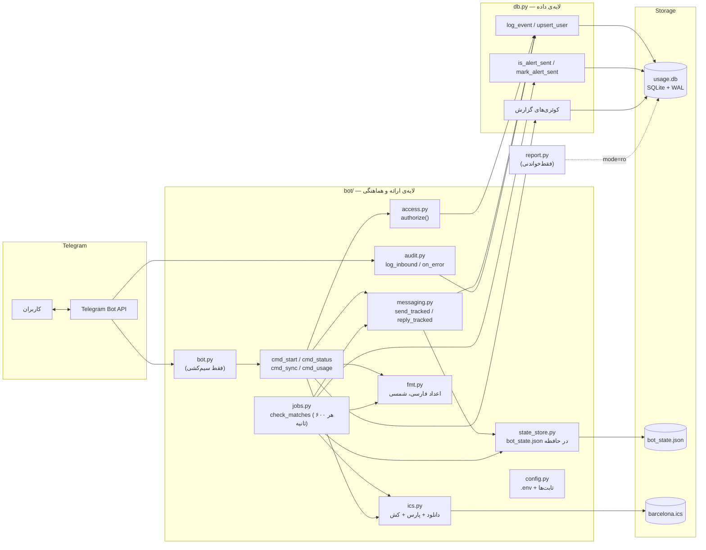
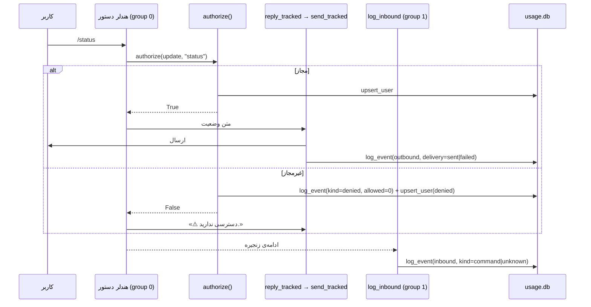
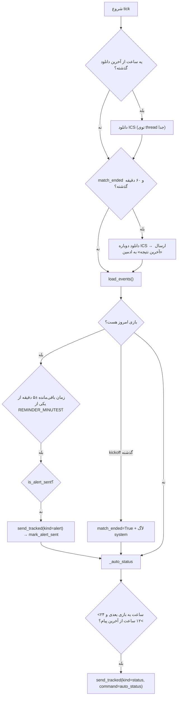

# 🏗️ معماری barca-bot

> ربات تلگرامی که بازی‌های بارسلونا رو از یه فایل تقویم (ICS) می‌خونه، قبل از بازی یادآوری می‌فرسته، با `/status` وضعیت رو نشون می‌ده و **همه‌ی تعامل‌ها** (ورودی، خروجی، خطا، تلاش غیرمجاز) رو توی SQLite ثبت می‌کنه.
>
> اصول طراحی: **کمترین کد**، **کمترین وابستگی** (دیتابیس فقط `sqlite3` استاندارد)، هر ماژول یه مسئولیت، و خرابیِ لاگ هیچ‌وقت ربات رو از کار نندازه.

---

## 🎯 ۱. اهداف و غیراهداف

### ✅ اهداف

- **G1** ثبت اینکه کی، با چه دستوری از ربات استفاده کرده.
- **G2** ثبت **متن دقیق** هر پیامی که ربات می‌فرسته (جواب دستورها، هشدارها، وضعیت خودکار).
- **G3** ثبت تلاش‌های غیرمجاز (چه کسی سعی کرد و رد شد).
- **G4** اعمال `ALLOWED_USERS` روی همه‌ی دستورها.
- **G5** گزارش برای ادمین از دو راه: دستور `/usage` توی تلگرام و اسکریپت `report.py` توی ترمینال.
- **G6** یادآوری خودکار قبل از بازی (چند بازه‌ی قابل‌تنظیم) **بدون ارسال تکراری بعد از ری‌استارت**.
- **G7** ارسال خودکار وضعیت وقتی کمتر از ۲۴ ساعت به بازی مونده و ۱۲ ساعت از آخرین پیام ربات به ادمین گذشته.

### 🚫 غیراهداف

- گروه/کانال (ربات تک‌کاربره؛ هشدارهای خودکار فقط برای ادمین می‌رن).
- داشبورد وب.
- آرشیو/Retention برای `usage_log` (حجم داده ناچیزه). فقط جدول `match_alerts` هر بار که ربات بالا میاد پاک‌سازی می‌شه.
- مهاجرت `parse_mode` قدیمیِ Markdown به HTML (توی «موارد باقی‌مانده» هست).

---

## 🗺️ ۲. نمای کلی



### 🧱 لایه‌ها و مسئولیت‌ها

| لایه | فایل‌ها | مسئولیت | کاری که **نمی‌کنه** |
| :--- | :--- | :--- | :--- |
| **ورودی/سیم‌کشی** | `bot.py` | ساخت `Application`، ثبت هندلرها، JobQueue، منوی دستورها | هیچ منطقی ندارد |
| **دستورها** | `cmd_*.py` | منطق هر دستور (احراز هویت → ساخت متن → ارسال) | SQL مستقیم، دانلود تقویم در مسیر دستور (فقط `/sync`) |
| **کنترل دسترسی** | `access.py` | `is_allowed`، `authorize`، استخراج فیلدهای کاربر | ارسال پیام |
| **ارسال** | `messaging.py` | ارسال پیام + لاگ نتیجه‌ی ارسال، به‌روزرسانی زمان آخرین پیام | تصمیم‌گیری درباره‌ی محتوا |
| **حسابرسی** | `audit.py` | لاگ ورودی (group 1) و هندلر خطا | جواب دادن به کاربر |
| **زمان‌بندی** | `jobs.py` | یادآوری‌ها، نتیجه‌ی بازی، وضعیت خودکار | وارد شدن توسط هندلرهای دستور |
| **تقویم** | `ics.py` | دانلود، پارس با کش (بر اساس `mtime`)، یافتن بازی‌ها | هیچ اطلاعی از تلگرام |
| **فرمت** | `fmt.py` | اعداد فارسی، تاریخ شمسی، زمان باقی‌مانده | I/O |
| **وضعیت** | `state_store.py` | یک `dict` مشترک در حافظه + ذخیره‌ی `bot_state.json` | — |
| **تنظیمات** | `config.py` | خواندن `.env`، ثابت‌ها، `ALLOWED_IDS` | منطق کسب‌وکار |
| **داده** | `db.py` | اسکیما، نوشتن رویداد، هشدارها، کوئری‌های گزارش | هیچ اطلاعی از تلگرام/`Update` |
| **گزارش** | `report.py` | خروجی متنی/CSV، **فقط‌خواندنی** | نوشتن روی دیتابیس |

> 💡 **جهت وابستگی‌ها:** `bot.py → cmd_* → (access, messaging, ics, fmt) → (db, state_store, config)`. `jobs.py` هم همین‌طوره و **هندلرهای دستور هرگز `jobs` رو import نمی‌کنن**.

---

## 🗄️ ۳. مدل داده

دیتابیس: `usage.db` (مسیر از `DB_PATH`؛ مسیر نسبی نسبت به پوشه‌ی پروژه تفسیر می‌شه، نه پوشه‌ی اجرا). حالت `WAL` فعاله تا `report.py` بتونه وسط نوشتنِ ربات بخونه. نسخه‌ی اسکیما با `PRAGMA user_version = 2` ثبت می‌شه.

### 📒 جدول `usage_log` — دفتر کل (append-only)

| ستون | نوع | توضیح |
| :--- | :--- | :--- |
| `id` | INTEGER PK | شناسه |
| `ts` | TEXT NOT NULL | زمان محلی به ISO-8601 |
| `kind` | TEXT NOT NULL | `command` \| `alert` \| `status` \| `system` \| `unknown` \| `denied` |
| `direction` | TEXT NOT NULL | `inbound` \| `outbound` |
| `command` | TEXT | اسم دستور یا رویداد بدون `/` (مثل `status`، `match_alert`، `auto_status`) |
| `user_id` / `username` / `first_name` | | مشخصات کاربر |
| `chat_id` / `chat_type` | | مشخصات چت |
| `text_sent` | TEXT | متن کامل پیام (outbound) یا متن پیام کاربر (inbound)؛ برای خطاها، ۲۰۰۰ کاراکتر آخر traceback |
| `allowed` | INTEGER DEFAULT 1 | `0` یعنی تلاش غیرمجاز |
| `delivery` | TEXT | `sent` \| `failed` \| `denied` \| `skipped` |
| `error` | TEXT | شرح خطا |
| `match_uid` | TEXT | UID بازی (برای هشدارها) |
| `extra` | TEXT | JSON آزاد |

**ایندکس‌ها:** `ts`، `user_id`، `kind`.

### 👥 جدول `users` — دایرکتوری کاربران

`user_id` (PK)، `username`، `first_name`، `first_seen`، `last_seen`، `total_events`، `denied_count`، `last_command`.
با `UPSERT` نگه داشته می‌شه. فقط از مسیر `authorize()` (و رد شدنِ `/usage`) به‌روز می‌شه؛ یعنی **فقط کسانی که دستور زدن** توش هستن، نه هر پیام آزادی.

### ⏰ جدول `match_alerts` — جلوگیری از هشدار تکراری

| ستون | توضیح |
| :--- | :--- |
| `match_uid` + `alert_type` | کلید اصلی؛ مثلاً `uid123` + `30m` |
| `sent` | `1` موفق، `0` هنوز نرفته یا شکست خورده (دفعه‌ی بعد دوباره تلاش می‌شه) |
| `sent_at` | زمان آخرین تغییر |
| `match_key` | `خلاصه_بازی + تاریخ‌ساعت` |

با هر بار بالا اومدن ربات، ردیف‌های قدیمی‌تر از ۳۰ روز پاک می‌شن (`cleanup_old_alerts`).

### 💾 فایل `bot_state.json` — وضعیت مشترک در حافظه

توسط `state_store` یک‌بار خونده می‌شه و بعد از هر تغییر ذخیره می‌شه.

| کلید | استفاده |
| :--- | :--- |
| `last_bot_message_time` | زمان آخرین پیام موفق به ادمین (قاعده‌ی «۱۲ ساعت»؛ از `last_status_send_time` قدیمی seed می‌شه) |
| `match_ended` / `match_ended_time` | بعد از kickoff ست می‌شه؛ ۶۰ دقیقه بعد نتیجه فرستاده می‌شه |
| `last_match_uid` / `last_match_summary` | آخرین بازیِ دیده‌شده (جلوگیری از ثبت دوباره‌ی پایان بازی) |
| `last_download_time` / `cooldown_until` | باقی‌مانده از نسخه‌های قبل؛ الان کسی نمی‌خونه‌شون |

> 🔒 `usage_log` هرگز آپدیت یا حذف نمی‌شه. `users` و `match_alerts` وضعیت‌اند، نه دفتر حسابرسی.

---

## 🔄 ۴. جریان داده

### ۴.۱ دستور ورودی (مثلاً `/status`)



نکته‌ها:

- ثبت ورودی **یک‌جا** توی `group 1` انجام می‌شه، نه توی هر هندلر؛ پس دستور جدید خودکار لاگ می‌شه.
- `group 1` بعد از `group 0` اجرا می‌شه و **همه‌ی** پیام‌ها رو می‌گیره. پیام غیردستوری با `kind='unknown'` ثبت می‌شه و جوابی نمی‌گیره.
- اگر کاربر غیرمجاز دستور بزنه، دو ردیف inbound ثبت می‌شه (یکی `denied` از `authorize`، یکی `command` از `log_inbound`). این رفتار فعلیه و عمداً دست‌نخورده مونده.

### ۴.۲ کار زمان‌بندی‌شده (`check_matches` — هر ۶۰۰ ثانیه)



- **پنجره‌ی هشدار:** هر مقدار توی `REMINDER_MINUTES` (پیش‌فرض `5,10,15,30,60`) با تلورانس ±۵ دقیقه چک می‌شه. چون job هر ۱۰ دقیقه اجرا می‌شه، این تلورانس تضمین می‌کنه هیچ بازه‌ای جا نمونه.
- **ضد تکرار:** `is_alert_sent` اگه ردیف نباشه می‌سازه (`sent=0`) و `False` برمی‌گردونه؛ بعد از ارسال موفق `mark_alert_sent` مقدار `sent=1` می‌زنه. این وضعیت توی دیسکه، پس ری‌استارت هشدار رو تکرار نمی‌کنه.
- **زمان آخرین پیام:** `send_tracked` برای هر پیامِ موفق به ادمین، `last_bot_message_time` رو توی `bot_state.json` به‌روز می‌کنه (قاعده‌ی «۱۲ ساعت» از همین تغذیه می‌شه).

### ۴.۳ گزارش‌گیری

| مسیر | مخاطب | روش | حالت |
| :--- | :--- | :--- | :--- |
| `/usage` | ادمین، توی تلگرام | توابع `db.py` با `readonly=True`؛ خروجی تکه‌تکه (۴۰۹۶ کاراکتر) | خواندن |
| `report.py` | ادمین، ترمینال | اتصال `mode=ro` مستقل (بدون import از پروژه) | فقط‌خواندنی |

---

## 🔐 ۵. کنترل دسترسی

| سطح | تعریف | دستورها |
| :--- | :--- | :--- |
| **غیرمجاز** | بیرون از `ALLOWED_IDS` | هیچ؛ فقط لاگ `denied` + پیام رد |
| **مجاز** | عضو `ALLOWED_USERS` یا `ADMIN_ID` | `/start` `/sync` `/status` |
| **ادمین** | فقط `ADMIN_ID` | همه + `/usage` |

- منبع حقیقت: `ALLOWED_IDS = set(ALLOWED_USERS) | {ADMIN_ID}`.
- اگه `ALLOWED_IDS` خالی باشه، **همه مجازن** و موقع بالا اومدن یه warning ثبت می‌شه. (برای همین `ALLOWED_USERS` یا `TELEGRAM_ADMIN_ID` رو حتماً ست کن.)
- `/usage` چک ادمین رو جدا انجام می‌ده؛ اگه `ADMIN_ID=0` باشه چک ادمین عملاً غیرفعاله.
- هر تلاش غیرمجاز **همیشه** ثبت می‌شه: `allowed=0`، `delivery='denied'` و `denied_count + 1`.

**چرا `authorize()` صریح و نه `filters.User(...)`؟** چون فیلتر آپدیت رو قبل از هندلر دور می‌ندازه؛ نه می‌شه دلیل رد رو ثبت کرد نه جواب داد. هدف اصلی ما اینه که بدونیم **کی تلاش کرده**.

---

## 📜 ۶. قراردادها

| موضوع | قرارداد | دلیل |
| :--- | :--- | :--- |
| **زمان** | naive و محلی، ISO-8601 | کل کد از `datetime.now()` استفاده می‌کنه؛ قاطی کردن با UTC فیلتر `--days` رو با منطق هشدارها ناسازگار می‌کنه |
| **خطای دیتابیس** | best-effort: `try/except` + `logger.exception` | خرابی لاگ نباید ربات رو از کار بندازه |
| **اتصال SQLite** | کوتاه‌مدت برای هر عملیات (`with connect()`) | JobQueue و هندلرها هم‌زمان اجرا می‌شن |
| **کارهای blocking** | `asyncio.to_thread` (دانلود ICS) | حلقه‌ی asyncio قفل نشه |
| **وضعیت مشترک** | `state_store.get()` فقط یک بار از دیسک می‌خونه | کپی‌های کهنه همدیگه رو overwrite نکنن |
| **کش تقویم** | پارس فقط وقتی `mtime` فایل عوض شده | دستورها سریع جواب بدن |
| **دانلود ICS** | موقع شکست، کش محلی استفاده می‌شه | ربات بدون اینترنتِ لحظه‌ای هم کار کنه |
| **طول پیام** | `/usage` در مرز ۴۰۹۶ کاراکتر تکه می‌شه | محدودیت تلگرام |
| **زبان رابط** | فارسی | سیاست پروژه |
| **ایمپورت و اجرا** | ایمپورت‌ها فلت‌اند؛ اجرا فقط با `python bot/bot.py`. `bot/bot.py` ریشه‌ی پروژه رو به `sys.path` اضافه می‌کنه (برای `db.py`) | کمترین تغییر کد؛ بدون `PYTHONPATH` |
| **ریشه‌ی پروژه** | `config.BASE_DIR` = پوشه‌ی بالای `bot/` | `.env`، `bot_state.json`، `barcelona.ics` و `usage.db` همه کنار `db.py` باشن |

---

## 🧩 ۷. هندلرها و گروه‌ها

```
group 0 ── CommandHandler("start")   → start()
        ── CommandHandler("sync")    → sync()
        ── CommandHandler("status")  → status()
        ── CommandHandler("usage")   → usage()          [ادمین]

group 1 ── MessageHandler(filters.ALL) → log_inbound()   [فقط ثبت، بدون پاسخ]

error_handler → on_error()                               [kind='system']
JobQueue      → check_matches()  هر ۶۰۰ ثانیه، اولین اجرا ۵ ثانیه بعد از شروع
```

منوی دستورهای تلگرام (`set_my_commands`) توی `post_init` ست می‌شه.

---

## ⚙️ ۸. پیکربندی

| متغیر | الزامی؟ | توضیح |
| :--- | :--- | :--- |
| `TELEGRAM_BOT_TOKEN` | ✅ | توکن ربات؛ بدون اون ربات بالا نمیاد |
| `TELEGRAM_ADMIN_ID` | ✅ (عملاً) | گیرنده‌ی هشدارها و تنها کاربر `/usage` |
| `ALLOWED_USERS` | توصیه می‌شه | آیدی‌های عددی با کاما؛ خالی = همه مجاز |
| `BOT_API_BASE_URL` | اختیاری | آدرس پروکسی Bot API (پیش‌فرض: Cloudflare Worker پروژه) |
| `REMINDER_MINUTES` | اختیاری | پیش‌فرض `5,10,15,30,60`؛ مقدار نامعتبر → پیش‌فرض + warning |
| `DB_PATH` | اختیاری | پیش‌فرض `usage.db` |

ثابت‌های کد (`config.py`): `ICS_URL`، `ICS_PATH`، `ICS_DOWNLOAD_INTERVAL = 3600`.

> `.env` باید توی **ریشه‌ی پروژه** (کنار `db.py`) باشه، نه توی `bot/`.

> `.env` با `os.environ.setdefault` خونده می‌شه؛ پس متغیر واقعیِ محیط **همیشه** روی `.env` برتری داره.

---

## 📁 ۹. ساختار فایل‌ها

```
.
├── Architecture.md       ← همین سند
├── README.md             ← راهنمای نصب و استفاده
├── project_structure.md  ← توضیح مفصل هر فایل
├── db.py                 ← لایه‌ی داده (SQLite)
├── report.py             ← گزارش‌گیری فقط‌خواندنی (CLI)
├── bot/                  ← پکیج فعال ربات
│   ├── bot.py            ← نقطه‌ی ورود (python bot/bot.py)
│   ├── config.py  access.py  audit.py  messaging.py
│   ├── cmd_start.py  cmd_status.py  cmd_sync.py  cmd_usage.py
│   ├── jobs.py  ics.py  fmt.py  state_store.py
├── .env                  ← تنظیمات و secretها (خارج از Git)
├── usage.db*             ← تولید خودکار؛ حاوی اطلاعات شخصی (خارج از Git)
├── bot_state.json        ← تولید خودکار
└── barcelona.ics         ← تقویمِ دانلودشده (کش)
```

`bot.py` تک‌فایلیِ قدیمی و `old_bot/` جزو پروژه‌ی فعال نیستن.

---

## 🧠 ۱۰. تصمیم‌های معماری (ADR خلاصه)

| # | تصمیم | جایگزین ردشده | دلیل |
| :-- | :--- | :--- | :--- |
| A1 | SQLite با `sqlite3` استاندارد | JSONL، SQLAlchemy | قابل کوئری، صفر وابستگی جدید |
| A2 | لاگ ورودی در `group 1` | لاگ توی هر هندلر | یک نقطه‌ی ثبت، غیرقابل فراموشی |
| A3 | `authorize()` صریح | `filters.User` | فیلتر قبل از ثبت رد می‌کنه |
| A4 | `/usage` فقط ادمین | همه‌ی کاربران مجاز | افشای آیدی و نام بقیه |
| A5 | اتصال کوتاه‌مدت SQLite | اتصال سراسری | امنیت در برابر دسترسی هم‌زمان |
| A6 | `report.py` فقط‌خواندنی و مستقل | ابزار مدیریتی با نوشتن | جداسازی گزارش از مسیر عملیاتی |
| A7 | **ماژولار شدن `bot/`** | یک فایل `bot.py` بزرگ | هر فایل یک کار؛ `bot.py` فقط سیم‌کشی |
| A8 | **هشدارها در جدول `match_alerts`** | `set` توی حافظه | بعد از ری‌استارت هشدار تکراری نره |
| A9 | **`send_tracked` تنها مسیر ارسال** | `bot.send_message` مستقیم | هیچ پیامی بدون لاگ نره |
| A10 | **`state_store` یک‌بار-بارگذاری** | خواندن فایل در هر tick | سرعت + نبود کپی کهنه |

---

## 💥 ۱۱. حالت‌های شکست

| سناریو | رفتار |
| :--- | :--- |
| `usage.db` قابل نوشتن نیست | ربات ادامه می‌ده؛ فقط `logger.error` |
| ارسال پیام شکست می‌خوره | ردیف `delivery='failed'` + `error`؛ استثنا بالا نمیاد؛ هشدار `sent=0` می‌مونه و tick بعدی دوباره تلاش می‌کنه |
| خطای غیرمنتظره توی هندلر | `on_error` ردیف `kind='system'` می‌زنه |
| ری‌استارت ناگهانی | WAL بازیابی می‌شه؛ هشدارهای ارسال‌شده دوباره نمی‌رن |
| دانلود `.ics` ناموفق | کش محلی استفاده می‌شه (اگه اصلاً فایلی نباشه، `False`) |
| بازی‌ی آینده‌ای توی تقویم نیست | `/status` پیام «بازی آینده‌ای یافت نشد» می‌ده (دیگه crash نمی‌کنه) و وضعیت خودکار کاری نمی‌کنه |
| `bot_state.json` خراب/ناموجود | با مقادیر پیش‌فرض ساخته می‌شه |

---

## 🔭 ۱۲. موارد باقی‌مانده (پیشنهاد)

1. **زمان «پایان بازی» دقیق نیست.** `jobs.py` وقتی kickoff می‌گذره `match_ended=True` می‌زنه و ۶۰ دقیقه بعد نتیجه رو می‌فرسته. چون بازی ~۱۱۵ دقیقه طول می‌کشه، نتیجه ممکنه **قبل از تموم شدن بازی** بره. راه‌حل: مبنا رو kickoff + ~۲ ساعت بذاری یا از `DTEND` تقویم استفاده کنی.
2. **`parse_mode="Markdown"` قدیمی** هنوز توی `/status`، هشدارها و وضعیت خودکار هست و متن‌ها `**bold**` دارن. اسم حریف/ورزشگاهِ حاوی `_` یا `*` می‌تونه باعث خطای `Can't parse entities` بشه (پیام رد می‌شه؛ بدتر اینکه توی لاگ `failed` می‌خوره). مهاجرت به HTML امن‌تره.
3. **پیام `/status` تکه نمی‌شه** (فقط `/usage` می‌شه). عملاً کوتاهه ولی تضمینی نیست.
4. **لاگ ورودیِ غیرمجاز دوتا ثبت می‌شه** (بخش ۴.۱). اگه آمار `report.py` برات مهمه، می‌تونی توی `log_inbound` ردیف‌های `denied` رو skip کنی.
5. **`verify=False` توی دانلود ICS** (طبق کامنت، میزبان لازم داره). ریسک MITM داره؛ اگه میزبان درست شد، فعالش کن.
6. **حریم خصوصی:** `usage_log` متن پیام‌های کاربران و آیدی/نام‌شون رو نگه می‌داره؛ `usage.db*` باید فقط توی `.gitignore` باشه و بکاپ‌ش هم محافظت‌شده.
