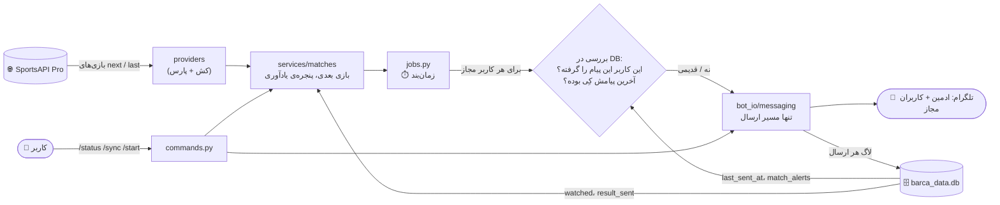
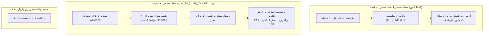

# 🏗️ معماری barca-bot (نسخه ۵ — یک دیتابیس، یادآوری برای همه‌ی کاربران مجاز)

## 🎯 ۱. ربات چه کاری می‌کند؟

ربات یک **یادآور بازی‌های بارسلونا** است و برای **هر کاربر مجاز** (همه‌ی `ALLOWED_USERS` + ادمین) جداگانه کار می‌کند:

- 📅 بازی‌های بارسلونا را از **SportsAPI Pro** می‌گیرد (با کش).
- ⏰ قبل از هر بازی، به **همه‌ی کاربران مجاز** یادآوری می‌فرستد (۶۰، ۳۰، ۱۵، ۱۰، ۵ دقیقه قبل).
- 📊 بعد از پایان بازی، **نتیجه** را برای همه‌ی کاربران مجاز می‌فرستد.
- 📡 **وضعیت خودکار:** هر چه به بازی نزدیک‌تر می‌شویم، ربات مراقب است هیچ کاربری بی‌خبر نماند. برای هر کاربر ذخیره می‌شود «آخرین پیام کِی رفته»؛ اگر بازی کمتر از ۲۴ ساعت دیگر است و بیشتر از ۱۲ ساعت از آخرین پیامِ آن کاربر گذشته، وضعیت بازی بعدی خودکار برایش می‌رود.
- 🗓️ `/status` آخرین نتیجه و بازی بعدی را نشان می‌دهد.
- 📢 `/broadcast_status` (فقط ادمین) همان متن `/status` را همان لحظه برای همه‌ی کاربران مجاز می‌فرستد.
- 🗒️ هر تعامل در SQLite ثبت می‌شود و فقط کاربران مجاز جواب می‌گیرند.

> اگر API خطا بدهد، کش قبلی نگه داشته می‌شود و یک دقیقه بعد دوباره تلاش می‌شود. خطا همیشه لاگ می‌شود و هیچ‌وقت به‌صورت «بازی‌ای نیست» نمایش داده نمی‌شود. منبع ICS حذف شده است.

---

## 🗺️ ۲. دیاگرام مفهومی

### 🔄 جریان کلی



### ⏱️ سه کار زمان‌بندی‌شده



### 🧱 لایه‌ها (جهت import فقط رو به پایین)

```
main.py → app.py → commands / jobs / audit        ← لایه‌ی بالا (وصل به تلگرام)
                         ↓
                      bot_io/                     ← ارسال پیام و دسترسی
                         ↓
                      services/                   ← منطق کسب‌وکار
                         ↓
         providers/   storage/   formatting/      ← API، دیتابیس، قالب‌بندی
                         ↓
                      settings.py                 ← به هیچ‌چیز وابسته نیست
```

---

## 📁 ۳. ساختار فایل‌ها

```
barca-bot/
├── main.py                 ← نقطه‌ی ورود: python main.py
├── app.py                  ← ساخت Application، ثبت هندلرها و job ها
├── settings.py             ← .env، مسیرها، ثابت‌ها (بدون import از پروژه)
├── commands.py             ← همه‌ی دستورها + جدول COMMANDS
├── jobs.py                 ← یادآوری، نتیجه، وضعیت خودکار (برای همه‌ی کاربران مجاز)
├── audit.py                ← لاگ پیام‌های ورودی + هندلر خطا
├── report.py               ← گزارش ترمینالی (فقط خواندن)
│
├── bot_io/                 ← هر چیزی که به تلگرام وصل است
│   ├── access.py           ← مجاز/غیرمجاز، recipients() = گیرنده‌های پیام
│   └── messaging.py        ← تنها مسیر ارسال؛ تکه‌کردن؛ لاگ هر پیام
│
├── services/               ← منطق کسب‌وکار (بدون تلگرام)
│   ├── matches.py          ← بازی بعدی، پنجره‌ی یادآوری، آخرین نتیجه
│   ├── tracking.py         ← بازی‌های منتظر نتیجه
│   ├── state.py            ← وضعیت بازی‌ها (رابط get/save، داده در barca_data.db)
│   └── reports.py          ← متن گزارش استفاده
│
├── providers/
│   └── sportsapipro.py     ← درخواست API، کش، تبدیل به دیکشنری ساده
│
├── storage/
│   └── sqlite.py           ← barca_data.db: لاگ، کاربران، هشدارها، وضعیت بازی‌ها، مهاجرت یک‌باره
│
├── formatting/             ← خالص (بدون I/O)
│   ├── fmt.py              ← ارقام فارسی، تاریخ شمسی/میلادی، زمان باقی‌مانده، برچسب روز (امشب/فرداشب)
│   ├── names.py            ← نام فارسی تیم‌ها و رقابت‌ها
│   └── status.py           ← قالب پیام نتیجه، بازی بعدی، یادآوری
│
├── tests/                  ← از جمله test_architecture.py (قانون وابستگی)
├── .env  barca_data.db  barca_cache.json   ← ریشه‌ی پروژه (ساخته‌ی اجرا/تو)
└── requirements.txt  pytest.ini  README.md  Architecture.md
```

### مسئولیت هر فایل

| فایل | کارش | کارش نیست |
| :--- | :--- | :--- |
| `main.py` | تنظیم لاگ، چک تنظیمات، ساخت دیتابیس، پاک‌سازی قدیمی‌ها، شروع | منطق کسب‌وکار |
| `app.py` | ساخت Application، ثبت هندلرها و job ها | منطق دستورها |
| `settings.py` | خواندن `.env`، مسیرها، ثابت‌ها | import از ماژول‌های پروژه |
| `commands.py` | همه‌ی دستورها + جدول `COMMANDS` | زمان‌بندی |
| `jobs.py` | یادآوری، نتیجه، وضعیت خودکار؛ حلقه روی همه‌ی کاربران مجاز | پاسخ به دستور |
| `audit.py` | لاگ ورودی و خطاهای ناخواسته | جواب دادن به کاربر |
| `bot_io/access.py` | مجاز/غیرمجاز، لیست گیرنده‌ها (`recipients()`) | ارسال پیام |
| `bot_io/messaging.py` | **تنها مسیر ارسال پیام**؛ تکه‌کردن؛ ارسال گروهی؛ لاگ هر تکه | تصمیم درباره‌ی محتوا |
| `services/matches.py` | بازی بعدی، پنجره‌ی یادآوری، آخرین نتیجه | قالب پیام |
| `services/tracking.py` | بازی‌های منتظر نتیجه | ارسال پیام |
| `services/state.py` | رابط خواندن/نوشتن وضعیت بازی‌ها | SQL مستقیم |
| `services/reports.py` | متن گزارش استفاده | تلگرام |
| `providers/sportsapipro.py` | API، کش، تبدیل به دیکشنری | قالب پیام |
| `storage/sqlite.py` | تمام جدول‌ها، لاگ، هشدارهای هر کاربر، `last_sent_at`، وضعیت بازی‌ها، مهاجرت، نگهداری داده | تلگرام |
| `formatting/*` | ارقام فارسی، تاریخ، برچسب روز، نام‌ها، قالب پیام‌ها | I/O |
| `report.py` | گزارش ترمینالی | نوشتن در دیتابیس |

**قانون وابستگی:** `services`، `providers`، `storage` و `formatting` هیچ‌وقت `telegram` یا `bot_io` را import نمی‌کنند و `formatting` به `settings` هم وابسته نیست. تنها `storage/sqlite.py` به SQLite دسترسی دارد. `tests/test_architecture.py` این را خودکار چک می‌کند.

---

## 🌐 ۴. منبع داده

| مورد | مقدار |
| :--- | :--- |
| آدرس پایه | `https://api.sportsapipro.com/v2/football` |
| احراز هویت | هدر `x-api-key` |
| بازی‌های آینده | `GET /teams/{TEAM_ID}/events/next/0` |
| بازی‌های اخیر | `GET /teams/{TEAM_ID}/events/last/0` |
| فیلدهای استفاده‌شده | `id`، `startTimestamp`، `status.type`، `homeTeam`/`awayTeam`، `homeScore.current`، `awayScore.current`، `tournament`، `venue` |

**دیکشنری بازی** (خروجی `_parse`): همه‌ی فیلدها نسبت به تیم ما هستند (`team`، `opponent`، `is_home`، `goals_for`، `goals_against`).

**کش (تطبیقی):**

| وضعیت | مدت کش |
| :--- | :--- |
| بازی‌های آینده، حالت عادی | ۲۴ ساعت |
| بازی‌های آینده، وقتی بازی در بازه‌ی −۳۰ تا +۱۲۰ دقیقه از شروع است («روز بازی») | ۱۰ دقیقه |
| بازی‌های اخیر | ۶ ساعت (job نتیجه با `force=True` خودش تازه می‌گیرد) |
| بعد از خطای API | back-off: بعد از خطای معمولی ۶۰ ثانیه و دو برابر در هر شکست؛ بعد از `429` طبق هدر `Retry-After` (یا ۱۵ دقیقه به بالا)؛ سقف ۱ ساعت |

- **کش روی دیسک (`barca_cache.json`):** آخرین داده‌ی سالم API ذخیره می‌شود. بعد از ری‌استارت یا وقتی API خطا/۴۲۹ می‌دهد، ربات بی‌صدا با همین داده کار می‌کند (بدون پیام خطا برای کاربر).
- `daily_sync` هر روز ساعت ۰۸:۰۰ (به وقت محلی) کش را تازه می‌کند.
- قبل از ارسال هر یادآوری، یک‌بار لیست تازه گرفته می‌شود تا اگر ساعت بازی عوض شده باشد پیام اشتباه نرود.
- `/sync` کش را دور می‌زند، ولی حداکثر هر ۳۰ ثانیه یک‌بار.
- سهمیه‌ی API بین همه‌ی ورزش‌های حساب مشترک است؛ وقتی `X-RateLimit-Remaining` زیر ۲۰ برود، هشدار لاگ می‌شود.

---

## 🏷️ ۴.۱ برچسب روز در پیام بازی بعدی

- خط «📆 تاریخ» در `/status`، یادآوری و وضعیت خودکار، کنارش یک برچسب دارد: **امروز / امشب / فردا / فرداشب / پس‌فردا / پس‌فرداشب**.
- ساعت مرز شب از `settings.NIGHT_FROM` (پیش‌فرض ۱۸:۳۰) خوانده می‌شود.
- بازی‌های **۰۰:۰۰ تا ۰۵:۵۹** جزو شب قبل حساب می‌شوند: تاریخ تقویمی می‌ماند و توضیح داخل پرانتز می‌آید، مثلاً «فردا - ۰۰:۳۰ بامداد، امشب».
- بیشتر از ۲ روز بعد یا گذشته، برچسبی نمی‌آید.
- منطق در `formatting/fmt.py` (تابع `day_label`) و کاملاً خالص است. `formatting` خودش `settings` را import نمی‌کند؛ `settings.NIGHT_FROM` از لایه‌ی بالا (`jobs` و `commands`) پاس داده می‌شود.

---

## ⏱️ ۵. job ها و قوانین ارسال

### گیرنده‌ها

`access.recipients()` همه‌ی `ALLOWED_IDS` (کاربران مجاز + ادمین) را برمی‌گرداند. اگر لیست خالی باشد فقط ادمین. **هر پیام خودکار برای هر گیرنده جداگانه** ارسال، بررسی و لاگ می‌شود؛ شکست ارسال برای یک نفر روی بقیه اثری ندارد.

### job ها

| job | تناوب | API؟ | کار |
| :--- | :--- | :--- | :--- |
| `check_reminders` | ۱ دقیقه | خیر (فقط کش) | یادآوری قبل از بازی برای همه |
| `check_results` | ۱۰ دقیقه | بله (در صورت نیاز) | نتیجه برای همه + وضعیت خودکار برای هر کاربر |
| `daily_sync` | روزی یک‌بار ۰۸:۰۰ | بله | تازه‌سازی لیست بازی‌ها |

### یادآوری

- یادآوری `m` وقتی می‌رود که `m - ۳ < دقیقه‌ی باقی‌مانده <= m`. پیام کهنه‌تر از ۳ دقیقه رد می‌شود.
- افق یادآوری `max(REMINDER_MINUTES)` است، نه «بازی‌های امروز»؛ پس بازی ساعت ۰۰:۳۰ یادآوری ۶۰ دقیقه‌اش را ساعت ۲۳:۳۰ روز قبل می‌گیرد.
- جلوگیری از تکرار: جدول `match_alerts` با کلید `(match_uid, alert_type, kickoff, user_id)`. یعنی **هر کاربر هر یادآوری را فقط یک‌بار** می‌گیرد، حتی بعد از ری‌استارت. اگر ساعت بازی عوض شود، `kickoff` تازه می‌شود و یادآوری دوباره می‌رود.
- نتیجه‌ی آخرین بازی در یادآوری فقط وقتی نشان داده می‌شود که بازی بعدی بیشتر از `HIDE_LAST_RESULT_WITHIN_MIN` (۲۴۰ دقیقه) دیر باشد.

### نتیجه

هر بازی آینده در `watched` ثبت می‌شود (جدول `watched_matches`، چون API ممکن است بعد از شروع آن را از لیست «آینده» حذف کند). ۹۰ دقیقه بعد از شروع، لیست «اخیر» تازه خوانده می‌شود و اگر بازی `finished` و دارای امتیاز بود، نتیجه برای **همه‌ی گیرنده‌ها** می‌رود (`alert_type='result'` در `match_alerts`). بعد از ۶ ساعت بی‌نتیجه، بازی رها می‌شود.

### 📡 وضعیت خودکار (برای هر کاربر)

```
برای هر کاربر u در recipients():
    اگر بازی بعدی وجود دارد
    و تا شروعش < ۲۴ ساعت مانده (AUTO_STATUS_WINDOW_H)
    و last_sent_at(u) خالی است یا بیشتر از ۱۲ ساعت پیش بوده (AUTO_STATUS_QUIET_H):
        → status_message برای u ارسال شود
```

- «آخرین پیام» از **دیتابیس** خوانده می‌شود (`storage.sqlite.last_sent_at(user_id)`: آخرین ردیف `usage_log` با `direction='outbound'` و `delivery='sent'` برای آن کاربر). چون **هر پیامی** که به کاربر برود (یادآوری، نتیجه، پاسخ دستور، وضعیت خودکار) از `messaging.py` رد و لاگ می‌شود، این زمان همیشه دقیق است و با ری‌استارت از بین نمی‌رود.
- نتیجه: کاربری که تازه یادآوری گرفته، وضعیت خودکار تکراری نمی‌گیرد؛ کاربری که ۱۲+ ساعت ساکت بوده و بازی نزدیک است، حتماً خبر می‌گیرد.

---

## 🗄️ ۶. داده‌ها

### `barca_data.db` (SQLite، WAL، نسخه‌ی اسکیمای ۵)

تمام داده‌ی ربات در یک فایل است.

| جدول | محتوا |
| :--- | :--- |
| `usage_log` | هر پیام ورودی/خروجی، خطا و تلاش غیرمجاز. منبع «آخرین پیام هر کاربر». بعد از `LOG_RETENTION_DAYS` (پیش‌فرض ۱۸۰) پاک می‌شود |
| `users` | دایرکتوری کاربران، تعداد رویداد، تعداد ردّ شدن |
| `match_alerts` | کلید `(match_uid, alert_type, kickoff, user_id)` و `sent`؛ ۳۰ روز نگه‌داری می‌شود |
| `watched_matches` | بازی‌های منتظر نتیجه: `match_uid`، `kickoff`، `summary` (قبلاً در `bot_state.json`) |
| `result_sent` | نتیجه‌های فرستاده‌شده به ترتیب ارسال (قبلاً در `bot_state.json`) |
| `meta` | مقدارهای کوچک؛ الان فقط `legacy_imported` را دارد که نشان می‌دهد مهاجرت انجام شده |

**مهاجرت:** در هر اجرا `init_db` بررسی می‌کند که `meta` کلید `legacy_imported` داشته باشد. اگر نه، `usage.db` (اگر باشد) و `bot_state.json` (اگر باشد) یک‌بار خوانده و وارد جدول‌ها می‌شوند و کلید ثبت می‌شود. بعد از آن این دو فایل دیگر خوانده نمی‌شوند. اگر `user_version` کمتر از ۴ باشد، `match_alerts` قدیمی حذف و با شکل جدید ساخته می‌شود (بدترین حالت: یک یادآوری تکراری برای هر کاربر).

### `barca_cache.json`

آخرین بازی‌های آینده/اخیر + زمان آخرین دریافت + زمان آزادشدن back-off. ساخته‌ی خودکار است و حذفش بی‌خطر است.

---

## ⌨️ ۷. دستورها و دسترسی

جدول `COMMANDS` در `commands.py` تنها منبع حقیقت است: هندلرها، منوی تلگرام، فیلتر `/start` و منطق جلوگیری از لاگ تکراری همه از آن ساخته می‌شوند.

| سطح | شرط |
| :--- | :--- |
| **غیرمجاز** | در `ALLOWED_USERS` و `TELEGRAM_ADMIN_ID` نیست. فقط «⚠️ دسترسی ندارید.» می‌گیرد و یک‌بار با `kind='denied'` ثبت می‌شود |
| **مجاز** | عضو `ALLOWED_USERS` یا ادمین: دستورها + **همه‌ی پیام‌های خودکار** |
| **ادمین** | `TELEGRAM_ADMIN_ID`: علاوه بر موارد بالا، `/usage` و `/broadcast_status`. اگر تنظیم نشود این دو دستور برای هیچ‌کس باز نیست |

`/status` و `/broadcast_status` هر دو همان قانون را دارند: اگر بازی بعدی کمتر از `HIDE_LAST_RESULT_WITHIN_MIN` دیگر باشد، نتیجه‌ی قبلی نشان داده نمی‌شود. `/broadcast_status` همان متن `/status` را همان لحظه برای همه‌ی گیرنده‌ها می‌فرستد (هر ارسال در لاگ با `kind='status'` و `command='broadcast_status'` ثبت می‌شود) و در پایان تعداد ارسال موفق را به ادمین می‌گوید. پیام‌های خودکار تغییری نکرده‌اند.

اگر `ALLOWED_USERS` و `TELEGRAM_ADMIN_ID` هر دو خالی باشند، همه می‌توانند دستورها را بزنند ولی چون گیرنده‌ای تعریف نشده، پیام خودکار نمی‌رود (هشدار لاگ می‌شود).

> ⚠️ کاربر باید حداقل یک‌بار به ربات `/start` بزند، وگرنه تلگرام اجازه‌ی پیام‌دادن ربات به او را نمی‌دهد (ارسال شکست می‌خورد و در لاگ `delivery='failed'` ثبت می‌شود).

---

## 🧠 ۸. تصمیم‌های معماری

| # | تصمیم | دلیل |
| :-- | :--- | :--- |
| D1 | ساختار مسطح، بدون پوشه‌ی هم‌نام پروژه | `python main.py` بدون `PYTHONPATH` |
| D2 | لایه‌بندی با قانون وابستگی یک‌طرفه + تست خودکار | تست‌پذیری و تعویض‌پذیری |
| D3 | همه‌ی دستورها در `commands.py` با جدول ثبت | دستور جدید = یک تابع + یک خط |
| D4 | داده‌ی بازی نسبت به تیم ما | کد نمایشی به `TEAM_ID` وابسته نیست |
| D5 | دو job اصلی (دقیقه‌ای از کش، ده‌دقیقه‌ای با API) | یادآوری دقیق بدون مصرف سهمیه |
| D6 | `settings.py` بدون import از پروژه | حذف حلقه‌ی import |
| D7 | تنها مسیر ارسال: `messaging.py` | هیچ پیامی بدون لاگ نرود |
| D8 | پیام‌های HTML با `html.escape` | نام‌های حاوی `_` و `*` خطا نمی‌دهند |
| D9 | `httpx` به‌جای `requests` | از قبل وابستگی `python-telegram-bot` است |
| D10 | منبع ICS حذف شد | کد ساده‌تر؛ بدون `verify=False` |
| D11 | **ارسال به‌ازای هر کاربر** (نه فقط ادمین) | همه‌ی اعضا بازی را از دست ندهند |
| D12 | **آخرین پیام هر کاربر از `usage_log`** (نه یک عدد سراسری) | یک منبع حقیقت، دقیق، پایدار بعد از ری‌استارت |
| D13 | `match_alerts` با `user_id` در کلید | هر کاربر هر یادآوری را دقیقاً یک‌بار می‌گیرد |
| D14 | کش تطبیقی (۲۴ ساعت / ۱۰ دقیقه در روز بازی) | سهمیه‌ی API حفظ شود ولی نزدیک بازی داده تازه باشد |
| D15 | **یک دیتابیس (`barca_data.db`) برای همه‌ی داده‌ها** | یک فایل برای پشتیبان‌گیری و نگهداری؛ وضعیت بازی‌ها هم کنار لاگ و هشدارها است |
| D16 | **مهاجرت یک‌باره با کلید `meta`** | داده‌ی قدیمی حفظ شود و دوباره وارد نشود |
| D17 | **ارسال گروهی دستی فقط در `messaging.py`** (`broadcast_tracked`) | مسیر ارسال یکی بماند و هر پیام لاگ شود؛ `jobs._broadcast` خصوصی جobs است و دوباره استفاده نشد |
| D18 | **برچسب روز در `formatting` با پارامتر `night_from`** (نه import از `settings`) | قانون وابستگی حفظ شود؛ `settings` در `jobs` و `commands` خوانده و پاس داده می‌شود |
| D19 | **`/status` و `/broadcast_status` مثل یادآوری نتیجه‌ی قبلی را پنهان می‌کنند** وقتی بازی بعدی نزدیک است | یک قانون برای همه‌ی پیام‌ها؛ قبلاً فقط یادآوری این کار را می‌کرد |

---

## ❓ ۹. موارد تأییدنشده

- `TEAM_ID=2817` برای بارسلونا؛ اگر اشتباه باشد ربات هشدار لاگ می‌دهد.
- ساختار `tournament` و `venue.city` / `venue.country` در پاسخ واقعی؛ اگر نباشند «نامشخص» یا بدون شهر نمایش داده می‌شود.
- مقادیر `status.type` غیر از `finished` (فقط `finished` لازم است).
- سهمیه‌ی روزانه‌ی حساب.
- تطابق نام تیم‌ها در `names.py` با نام‌های API؛ اگر نبود، نام انگلیسی نشان داده می‌شود.
- محدودیت تلگرام در ارسال انبوه (حدود ۳۰ پیام در ثانیه)؛ برای تعداد کاربرِ کم مشکلی نیست.
- مرز بامداد (۰۶:۰۰) فرض است؛ برای تغییر، `EARLY_MORNING_BEFORE_HOUR` را در `formatting/fmt.py` عوض کن.

## 🧭 ۱۰. کارهای آینده

- نمایش بازی در حال انجام (نیازمند تأیید مقادیر `status.type`).
- امکان خاموش‌کردن یادآوری توسط هر کاربر (مثلاً `/mute`).
- استیکر واقعی با `file_id` به‌جای ایموجی.